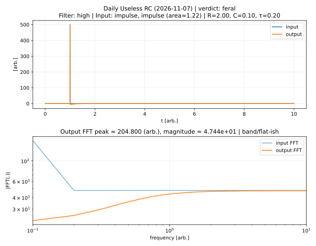

# Daily Useless Physics

Every day, GitHub Actions generates a **random dynamical system**
and excites it with a **random input signal**.

## Today's Result (2026-11-12)

- **System**: RLC
- **Filter kind (random by system)**: band
- **Parameters**: R=0.382, L=1.00, C=0.20, ωn=2.24, ζ=0.085, Q=5.86
- **Input**: noise (σ≈0.46)

### Useless judgement
- **verdict**: **feral**
- overshoot-ish: 0.678
- wiggles: 1350
- FFT peak (output): 0.300 (arb.)
- rough shape guess from |Y|/|X|: low-ish

> We observed a rare event: uncontrolled confidence.

