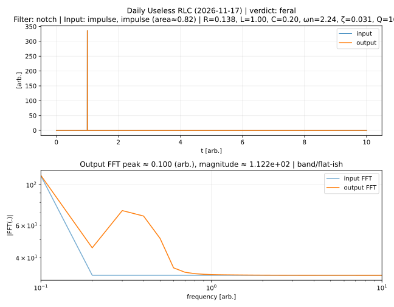

# Daily Useless Physics

Every day, GitHub Actions generates a **random dynamical system**
and excites it with a **random input signal**.

## Today's Result (2026-11-19)

- **System**: RLC
- **Filter kind (random by system)**: high
- **Parameters**: R=0.091, L=0.50, C=5.00, ωn=0.63, ζ=0.144, Q=3.47
- **Input**: square (A=0.83, f=0.34 Hz)

### Useless judgement
- **verdict**: **calm**
- overshoot-ish: 0.190
- wiggles: 7
- FFT peak (output): 0.300 (arb.)
- rough shape guess from |Y|/|X|: band/flat-ish

> The dynamics were suspiciously polite.

