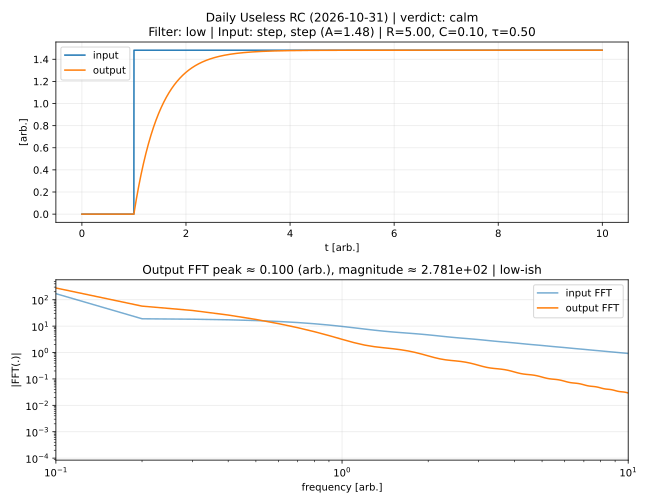

# Daily Useless Physics

Every day, GitHub Actions generates a **random dynamical system**
and excites it with a **random input signal**.

## Today's Result (2026-10-17)

- **System**: RC
- **Filter kind (random by system)**: low
- **Parameters**: R=10.00, C=1.00, τ=10.00
- **Input**: step (A=1.26)

### Useless judgement
- **verdict**: **calm**
- overshoot-ish: 0.068
- wiggles: 0
- FFT peak (output): 0.100 (arb.)
- rough shape guess from |Y|/|X|: low-ish

> Nothing happened. Therefore, it is perfect.

